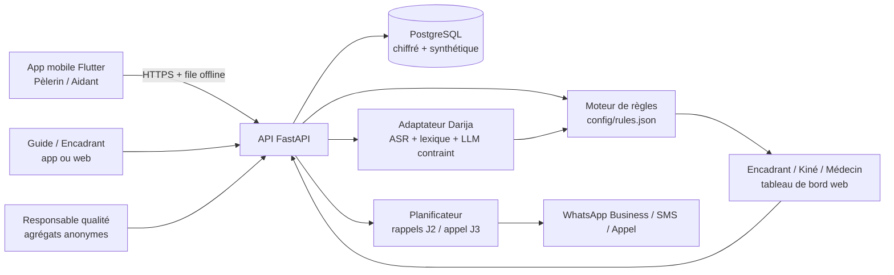
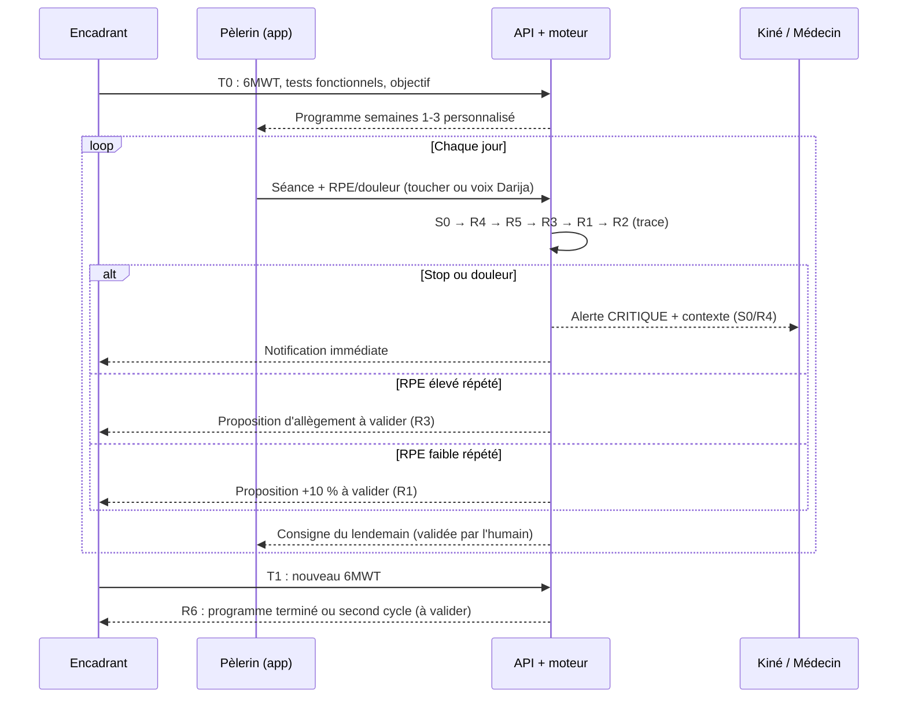

# 00 — Vue d'ensemble architecturale (MVP 1.0)

## 1. Le problème adressé

Le certificat médical d'aptitude valide le **départ**, mais ne teste pas la
**capacité à l'effort** : marche 5 à 15 km/jour, piétinement, lever/asseoir au
sol, ports de force légers, chaleur, dette de sommeil et répétition sur six
jours consécutifs (8 → 13 dhou al-hijja). Il existe donc une **fossé de charge** :

```
Charge imposée par le parcours  >  Capacité fonctionnelle réelle du pèlerin
        ↓
épuisement, complications, interruption des rites, perte de confiance
```

Le MVP ne cherche pas à « remettre en forme » au sens sportif général. Il vise à
**augmenter le harnais fonctionnel** (capacité − charge) sur des gestes qui
reproduisent le parcours, avec une supervision humaine et un arrêt immédiat
sécurisé.

## 2. Personas (tous synthétiques)

| Persona | Besoin principal | Canal |
| --- | --- | --- |
| **الحاج أحمد**, 63 ans, sédentaire, Darija, téléphone basique | Comprendre quoi faire aujourd'hui et se sentir suivi | Application senior + WhatsApp |
| **Aidant familial** (fils/fille) | Aider sans usurper la décision clinique | Mode « aidant » de l'app |
| **المؤطر** (encadrant terrain) | Voir qui va mal **en premier**, et intervenir | Tableau de bord web/mobile |
| **Kinésithérapeute / médecin** | Recevoir les alertes douleur/stop avec le contexte | Alertes priorisées + dossier |
| **Responsable qualité agence** | Mesurer l'impact et capitaliser sur la saison | Indicateurs agrégés anonymes |

## 3. Principes de conception du modèle (issus du guide pédagogique)

1. **Spécificité** — s'entraîner aux gestes du parcours (marche, station debout,
   lever du sol, escaliers).
2. **Progression** — durée d'abord, intensité ensuite, planifiée à rebours de la date de départ.
3. **Individualisation** — niveau de départ déterminé par T0, pas par l'âge seul.
4. **Simulation** — enchaîner des jours consécutifs, pas une séance isolée.
5. **Gestion de la charge** — RPE, douleur, repos, hydratation.
6. **Sécurité et supervision** — critères de stop, décision professionnelle obligatoire.

## 4. Architecture cible du prototype



### Choix techniques et justifications

| Couche | Choix MVP | Raison |
| --- | --- | --- |
| Mobile | Flutter 3 / Dart, RTL natif | Un seul code, rendu AR fiable, widget accessibles, cache local offline pour les jours de forte affluence où le réseau est incertain |
| API | Python 3.11 + FastAPI | Même langage que le moteur de règles et le NLP ; validation Pydantic ; traçabilité facile |
| Règles | Moteur déterministe own-code, configuration JSON versionnée | Explicable, auditable, testable sans service externe ; aucun « black box » sur la sécurité |
| NLP Darija | ASR + lexique règles + LLM contraint en sortie JSON schema | Le lexique couvre les expressions critiques ; le LLM ne fait que normaliser, il ne décide jamais |
| Persistance | PostgreSQL (UUID, JSONB pour les traces) + chiffrement au repos | Requêtes de suivi, audit immuable, agrégation anonyme |
| Messagerie | WhatsApp Business API (canal déjà utilisé par le persona), SMS en repli | Adoption par le public cible |
| Planificateur | Celery Beat / cron (quotidien 07h00 Africa/Casablanca) | R5 doit être évaluée même sans ouverture de l'app |
| Observabilité | Logs structurés + `trace_id` sur chaque décision | Reconstitution complète d'une alerte |

## 5. Boucle de fonctionnement



Le point clé : **aucun changement de charge n'est appliqué sans validation
humaine**. `R2` (maintien) est la seule décision modifiant l'interface sans
validation, précisément parce qu'elle ne modifie rien.

## 6. Niveaux d'IA livrés

- **Niveau 0 (obligatoire)** — moteur de règles explicable, paramétrable, testé
  (28 tests automatiques, `tests/test_rules_engine.py`).
- **Niveau 1 (obligatoire au choix)** — extraction Darija voix/texte →
  indicateurs structurés avec provenance, confiance et demande de confirmation.
- **Niveau 2 (livré en complément, sans opaque)** — tri du tableau de bord :
  score de priorité calculé **uniquement à partir des décisions du moteur** et
  affiché avec sa justification (`règle + preuves + trace`). Aucun classifieur
  opaque n'est nécessaire pour le MVP.

## 7. Indicateurs d'impact (et non d'activité)

| Niveau | Indicateur | Source |
| --- | --- | --- |
| Capacité | % de pèlerins avec 6MWT amélioré entre T0 et T1 | Évaluations T0/T1 |
| Parcours | % ayant terminé les rites sans interruption liée à l'épuisement | Registre quotidien + entretien retour |
| Sécurité | Délai médian entre alerte « j'ai besoin d'aide » et intervention | Horodatages alertes/interventions |
| Organisation | Nombre d'interventions liées à l'effort vs saison précédente | Journaux encadrants/agences |

> Le nombre de téléchargements ou de séances enregistrées est un indicateur
> **d'usage** : il ne démontre pas l'amélioration de la condition physique.

## 8. Hors périmètre du MVP

Diagnostic médical, prescription d'exercices thérapeutiques, constants
physiologiques (FC, SpO₂) sans dispositif validé, collecte de données réelles,
gestion des 14 stations du parcours dans leur exhaustivité, traduction multilingue
(arabe standard + Darija + français uniquement), paiement / billetterie.
