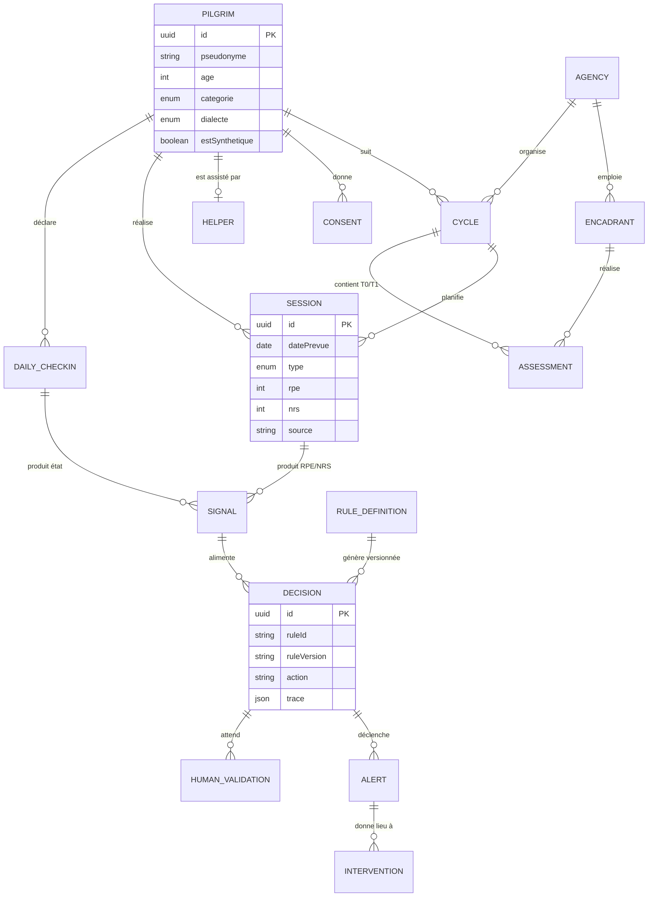

# 01 — Modèle de données simplifié (MVP)

Convention : tous les identifiants sont des UUID ; les exemples utilisent le
préfixe `SYNTH-` pour rappeler que les données sont **exclusivement
synthétiques**. Les champs de santé sont minimisés : aucune donnée diagnostique
n'est stockée, seulement des **résultats de tests fonctionnels** saisis par un
professionnel.

## 1. Diagramme entité-relation



## 2. Dictionnaire des entités

### `Pilgrim` — Pèlerin (synthétique)

| Champ | Type | Contraintes / notes |
| --- | --- | --- |
| `id` | UUID | PK |
| `pseudonyme` | string | Ex. `الحاج أحمد (SYNTH-001)` — jamais un vrai nom |
| `age` | int | Ex. 63 ; utilisé pour l'ergonomie, **jamais comme seule règle de décision** |
| `categorie` | enum | `SENIOR`, `ACTIF`, `MOBILITE_REDUITE`, `MALADIE_CHRONIQUE` (cumulables via table de jointure en v2) |
| `dialecte` | enum | `DARIJA`, `ARABE_STANDARD` |
| `helperId` | UUID? | FK `Helper`, mode aidant |
| `encadrantId` | UUID | FK `Encadrant` |
| `agencyId` | UUID | FK `Agency` |
| `estSynthetique` | boolean | `true` partout dans le MVP ; contrôle CI |
| `contactPrefere` | enum | `WHATSAPP`, `SMS`, `APPEL` |

### `Consent` — Consentement (versionné)

| Champ | Type | Notes |
| --- | --- | --- |
| `id`, `pilgrimId` | UUID | |
| `versionFormulaire` | string | Ex. `consent-v1.0` |
| `portees` | string[] | `SUIVI_SEANCE`, `TRAITEMENT_VOCAL`, `ALERTE_ENCADRANT`, `STATISTIQUES_ANONYMES` |
| `dateAccord`, `dateRetrait` | datetime | Le retrait désactive les traitements vocaux et les rappels |

### `Agency`, `Encadrant`, `Clinician`, `Helper`

`Acteur` est la table mère : `id`, `role` (`ENCADRANT`, `KINE`, `MEDECIN`,
`QUALITE`, `AIDANT`), `agenceId`, `langue`, `actif`. L'encadrant est titulaire
d'une **délégation de validation** limitée aux propositions `R1`/`R3` ; les
alertes `S0`/`R4` requièrent un `KINE` ou un `MEDECIN`.

### `Cycle` — Période de préparation

| Champ | Type | Notes |
| --- | --- | --- |
| `id`, `pilgrimId`, `agencyId` | UUID | |
| `numeroCycle` | int | 1 ou 2 (R6 peut proposer le cycle 2) |
| `dateDebut`, `dateFin` | date | Semaines 1 → 3 (14 jours actifs du kit + semaine de simulation) |
| `dateDepartHajj` | date | Ancrage du planning à rebours |
| `objectif6MWT` | int | **Fixé par l'encadrant**, jamais par l'IA |
| `statut` | enum | `EN_COURS`, `TERMINE_A_VALIDER`, `TERMINE`, `SECOND_CYCLE_PROPOSE` |

### `Assessment` — Test fonctionnel (T0 / T1)

| Champ | Type | Notes |
| --- | --- | --- |
| `id`, `cycleId`, `realisePar` | UUID | |
| `type` | enum | `T0`, `T1` |
| `sixMwtMetres` | int | Test de marche 6 minutes — indicateur principal R6 |
| `leverDeSolReussi` | boolean | Force/ mobilité hanche-genou |
| `unilateralStanceSec` | int | Équilibre statique |
| `sitToStand30s` | int | Force membres inférieurs |
| `timedUpAndGoSec` | int | Mobilité dynamique |
| `postureConfortableMin` | int | Tolérance positionnelle |
| `date`, `commentaire` | datetime, string | |

### `Session` — Séance planifiée / réalisée

| Champ | Type | Notes |
| --- | --- | --- |
| `id`, `cycleId`, `pilgrimId` | UUID | |
| `datePrevue`, `dateRealisation` | date | |
| `semaine` | int | 1, 2 ou 3 (interface 3) |
| `type` | enum | `MARCHE`, `STATION_DEBOUT`, `LEVER_SOL`, `ESCALIERS`, `RECUPERATION_HYDRATATION` |
| `dureePrevueMin`, `dureeReelleMin` | int | Cible de la progression ±10 % (R1/R3) |
| `distancePrevueKm` | decimal | 5 → 15 km progressifs selon le niveau |
| `rpe` | int? | 0–10 (interface 5) |
| `nrs` | int? | 0–10 (interface 5) |
| `statut` | enum | `PLANNEE`, `TERMINEE`, `SUSPENDUE`, `MANQUEE` |
| `source` | enum | `MANUAL`, `VOICE_DARIJA`, `WHATSAPP`, `AIDANT` |
| `confiance`, `confirmee` | float, boolean | Traçabilité NLP (voir §4) |
| `syncState` | enum | `LOCAL`, `SYNCEE` (mode offline-first) |

### `DailyCheckIn` — Registre quotidien (interface 8)

`id`, `pilgrimId`, `date`, `etat` (`BIEN`, `FATIGUE`, `BESOIN_AIDE`),
`rpe?`, `nrs?`, `source`, `confiance`, `confirmee`, `heureSoumission`.
Deux points par jour pendant les rites ; un le matin en préparation.

### `Signal` — Observation unifiée (vue logique)

Normalise `Session` et `DailyCheckIn` en `(type, valeur, échelle, date, source,
confiance, confirmee, drapeaux)`. C'est l'entrée du moteur de règles : celui-ci
ne connaît pas la table d'origine, seulement le signal.

### `RuleDefinition` — Règle versionnée

| Champ | Type | Notes |
| --- | --- | --- |
| `id` | string | `S0`, `R1`…`R6`, `CONFIRM` |
| `version` | string | `1.0.0`, alignée sur `engine.version` |
| `priorite` | int | 0 = S0 (non contournable) |
| `active` | boolean | Paramétrable sans redéploiement |
| `parametres` | JSONB | Seuils copiés depuis `config/rules.json` |
| `messages` | JSONB | Templates FR / AR |
| `validePar` | UUID | Responsable sportif + validation qualité |

### `Decision` — Décision explicable (immuable)

| Champ | Type | Notes |
| --- | --- | --- |
| `id`, `ruleId`, `ruleVersion` | UUID, string | Version figée dans la décision |
| `action` | enum | `SUSPENDRE_IMMEDIATEMENT`, `ALERTER_KINE_MEDECIN`, `PROPOSER_ALLEGEMENT`, `PROPOSER_AUGMENTATION_DUREE`, `MAINTENIR_CHARGE`, `RAPPEL_AUTOMATIQUE`, `APPEL_ENCADRANT`, `VALIDER_PROGRAMME`, `PROPOSER_SECOND_CYCLE`, `DEMANDER_CONFIRMATION`, `AUCUNE_ACTION` |
| `severite` | enum | `INFO`, `WARNING`, `CRITICAL` |
| `chargeUtile` | JSONB | `%`, durées proposées, NRS, jours d'inactivité… |
| `preuves` | JSONB | IDs des séances/signaux + valeurs lues |
| `explication` | JSONB | `{fr, ar}` générée depuis le template |
| `trace` | JSONB | Règles évaluées, raison de non-déclenchement |
| `statutHumain` | enum | `EN_ATTENTE`, `VALIDE`, `REFUSE`, `MODIFIE` |
| `traceId` | string | Corrélation logs/audit |

### `Alert` / `Intervention` / `HumanValidation`

- `Alert` : `decisionId`, `severite`, `destinataires[]`, `canal`, `statut`
  (`CREEE`, `ENVOYEE`, `ACCUSEE`, `ESCALADEE`, `CLOS`), `slaMinutes`, horodatages.
- `Intervention` : `alertId`, `encadrantId`, `type` (`APPEL`, `VISITE`,
  `CONSEIL`), `note`, `date` — alimente l'indicateur « délai de réponse ».
- `HumanValidation` : `decisionId`, `validateurId`, `role`, `decisionFinale`,
  `commentaire`, `date` — **aucune action de charge n'est appliquée sans ligne ici**.

### `AuditEvent`

Journal append-only : `acteur`, `action`, `objet`, `avant`, `apres`, `traceId`,
`date`. Les traces de décision et les consentements y sont également écrits.

## 3. Exemple JSON (données synthétiques)

Voir [`examples/synthetic_pilgrim.json`](../examples/synthetic_pilgrim.json).

```json
{
  "id": "SYNTH-001",
  "pseudonyme": "الحاج أحمد (SYNTH-001)",
  "estSynthetique": true,
  "cycle": {
    "numeroCycle": 1,
    "objectif6MWT": 400,
    "semaines": [1, 2, 3]
  },
  "evaluationT0": { "sixMwtMetres": 350, "sitToStand30s": 11 },
  "derniereSeance": {
    "id": "SYNTH-SESSION-014",
    "rpe": 4,
    "nrs": 1,
    "dureePrevueMin": 20,
    "source": "MANUAL"
  }
}
```

## 4. Règles de gouvernance des données

1. **Synthetic by design** : `estSynthetique = true` obligatoire ; un test CI
   refuse tout jeu de données sans ce drapeau ou avec un numéro de téléphone
   ressemblant à un vrai numéro marocain.
2. **Minimisation** : pas de diagnostic, pas de traitement, pas de tension,
   pas de poids saisi dans le MVP.
3. **Provenance** : toute valeur issue de la voix porte `source`,
   `confiance`, `confirmee` ; la confirmation humaine est requise avant
   changement de charge.
4. **Rétention** : traces d'alertes conservées 1 saison + 3 mois pour le
   retour d'expérience, puis agrégation anonyme ; consentement retiré →
   suppression des données vocales brutes immédiate.
5. **Indexation** : `(pilgrimId, date DESC)` sur `Session` et `DailyCheckIn`,
   `(statut, severite, createdAt DESC)` sur `Alert`, `traceId` sur `AuditEvent`.
