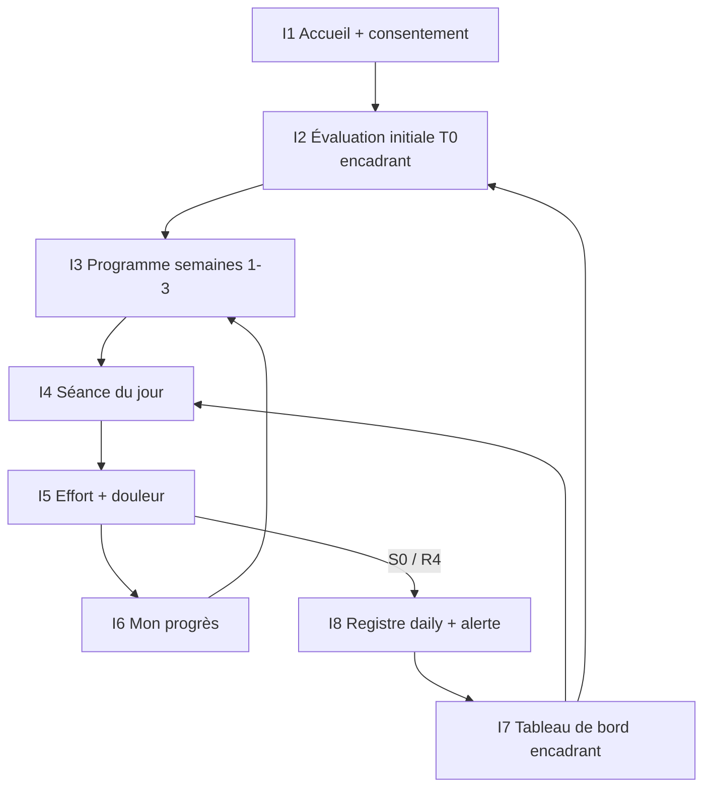

# 03 — Conception des 8 interfaces obligatoires

## 0. Système de design « senior » (appliqué aux 8 écrans)

| Exigence | Spécification |
| --- | --- |
| Cibles tactiles | ≥ 56 × 56 dp (recommandation MVP), espacement ≥ 12 dp |
| Typographie | ≥ 18 sp pour le corps, ≥ 24 sp pour les titres, police AR lisible (Noto Naskh Arabic / Cairo) |
| Contraste | ≥ 7:1 pour le texte principal, ≥ 4.5:1 pour les icônes (fond clair, texte foncé) |
| Icônes | **jamais seules** : icône + libellé texte en Darija (+ FR en second) |
| RTL | Mise en page arabe de droite à gauche ; les chiffres et les flèches restent unwrapped |
| Voix | Micro persistant sur les écrans de saisie ; dictée Darija + confirmation visuelle |
| Charge cognitive | Une seule action principale par écran ; maximum 3 choix visibles ; pas de menu caché |
| Sécurité | Bouton « STOP » rouge toujours visible pendant la séance ; jamais de confirmation en 2 temps pour l'arrêt |
| Erreur | Message en langage simple + bouton « réessayer » + repli téléphone/aidant |
| Hors-ligne | Les 8 écrans fonctionnent en local ; synchronisation différée avec indicateur discrect |

## 1. Carte de navigation



## 2. Matrice règle ↔ interface (numéros indiqués dans le cahier des charges)

| Interface | Acteur | Règles associées | Action principale |
| --- | --- | --- | --- |
| I1 Accueil & consentement | Pèlerin | Sécurité / consentement (préalable à S0) | Donner son accord et entrer |
| I2 Évaluation initiale T0 | Encadrant | R6 (référence T0 et objectif) | Enregistrer les 5 tests fonctionnels |
| I3 Programme des semaines 1–3 | Pèlerin | **R1, R2, R3** (charge ajustée) | Ouvrir la semaine / voir la séance du jour |
| I4 Séance du jour (matrice) | Pèlerin | S0 + application de R1/R3 | Démarrer la séance (et STOP toujours disponible) |
| I5 Enregistrement effort & douleur | Pèlerin | **R1 à R4** (+ S0) | Envoyer mon effort et ma douleur |
| I6 Mon progrès | Pèlerin | **R6** | Voir mon évolution 6MWT et mon statut |
| I7 Tableau de bord encadrant | Encadrant / Kiné / Médecin | **R3, R4, R5** (+ S0, R6) | Traiter le cas prioritaire |
| I8 Registre quotidien & alerte | Pèlerin / Guide | **R4** (+ R5, S0) | Déclarer mon état du jour |

---

## I1 — Accueil et consentement (Sécurité)

**Objectif** : expliquer en 3 phrases ce que fait l'application, obtenir un
consentement éclairé et versionné, fournir un bouton d'urgence visible dès
l'entrée.

```text
┌──────────────────────────────────────┐
│ جاهز  ·  Jahiz                       │
│ [Logo] رفيقك في الطريق · خدمة الحاج │
├──────────────────────────────────────┤
│ مرحبا الحاج أحمد                     │
│ 3 خطوات بسيطة قبل الحج               │
│ ① تقييم بسيط  ② تمارين كل يوم        │
│ ③ متابعة مع المؤطر                   │
├──────────────────────────────────────┤
│ ⚠️ الموافقة / Consentement v1.0      │
│ ☑ متابعة التمارين                    │
│ ☑ التسجيل الصوتي (Darija)            │
│ ☑ تنبيه المؤطر عند التعب             │
│ [📖 اقرأ بالداريja]  [🔊 اسمع]        │
├──────────────────────────────────────┤
│  [ ✅ أنا موافق / أبدأ ]   ← CTA     │
│  [ 🆘 كاين شي مشكل؟ ]  (appel guide) │
└──────────────────────────────────────┘
```

- **Action principale** : `أنا موافق / أبدأ` → crée `Consent(consent-v1.0)` puis ouvre I3 (ou I2 si l'encadrant doit encore faire T0).
- **Règle associée** : précondition de sécurité ; aucun signal n'est traité avant consentement. Le bouton `🆘` ouvre directement le flux S0.
- **États** : premier lancement, consentement retiré (return ici), version de formulaire mise à jour.
- **Accessibilité** : cases à cocher larges, lecture audio du texte, aucun jargon médical.

## I2 — Évaluation initiale T0 (Encadrant)

**Objectif** : capturer la référence fonctionnelle et fixer l'objectif 6MWT qui servira à R6.

```text
┌──────────────────────────────────────┐
│ التقييم الأولي · T0                  │
│ الحاج أحمد (SYNTH-001) · 63 سنة      │
├──────────────────────────────────────┤
│ ① مشي 6 دقائق      [ 350 ] م   ✅   │ ← indicateur R6
│ ② النهوض من الكرسي 30ث [ 11 ] مرة    │
│ ③ الوقوف على رجل واحدة [ 8 ] ثانية   │
│ ④ القيام من الأرض    [ ☐ نعم ]      │
│ ⑤ المشي والنهوض الموقوت [ 12 ] ثانية │
├──────────────────────────────────────┤
│ الهدف المتفق عليه: [ 400 ] م (T1)    │ ← saisi par l'humain
│ ⓘ المنصة تقترح وتسجل، والقرار لك     │
├──────────────────────────────────────┤
│ [ 💾 حفظ التقييم T0 ]  ← CTA         │
└──────────────────────────────────────┘
```

- **Action principale** : enregistrer T0 + objectif → création du `Cycle` et génération du programme semaines 1–3.
- **Règle associée** : **R6** (T0 sert de référence et l'objectif est la condition seconde de validation).
- **Données** : `Assessment`, `Cycle.objectif6MWT`.
- **États** : tests partiels (barre de progression 3/5), valeur manquante bloquante pour R6, modification autorisée par l'encadrant seulement.

## I3 — Programme des semaines 1 à 3 (Pèlerin)

**Objectif** : rendre visible la charge à venir et les ajustements décidés par l'encadrant.

```text
┌──────────────────────────────────────┐
│ برنامجي · الأسبوع 1 من 3             │
│ الأحد  الإثنين  الثلاثاء ...          │
├──────────────────────────────────────┤
│ ⬅ الأسبوع 1 │ 2 │ 3 ➡               │
│ اليوم 3: مشي 22 دقيقة ✅             │
│ اليوم 4: مشي 22 دقيقة  👈 CTA        │
│ اليوم 5: وقوف + نهوض من الأرض        │
├──────────────────────────────────────┤
│ ℹ️ تكييف مقترح من المؤطر:            │
│ "زidation 10% مقبولة" → +2 دقائق     │ ← trace R1 visible
│ [ ✔️ موافقة المؤطر مطلوبة ]          │
├──────────────────────────────────────┤
│ [ 🚶 ابدأ حصة اليوم ]  ← CTA         │
└──────────────────────────────────────┘
```

- **Action principale** : ouvrir la séance du jour (I4).
- **Règles associées** : **R1** (proposition +10 %), **R2** (maintien), **R3** (proposition −15 %) ; la charge affichée est celle **validée** par l'encadrant, pas la proposition brute.
- **Données** : `Cycle`, `Session.planifiee`, `Decision.statutHumain`.
- **États** : proposition en attente (badge « بانتظار المؤطر »), séance manquée (déclencheur R5), semaine 3 = simulation des jours consécutifs.

## I4 — Séance du jour — matrice (Pèlerin)

**Objectif** : guider pas à pas l'exécution, avec arrêt immédiat toujours accessible.

```text
┌──────────────────────────────────────┐
│ حصة اليوم · الأربعاء                 │
│ [🚶] المشي 22 دقيقة  [⏱ 22:00]       │
├──────────────────────────────────────┤
│ ① قبل: اشرب الماء 🥛  [تم ✅]        │
│ ② مشي بخطى بطيئة 🚶  [جاري…]         │
│ ③ وقوف 30 ثانية 🧍  [قريبًا]         │
│ ④ نهوض من الأرض 🧘  [قريبًا]         │
├──────────────────────────────────────┤
│ 🚩 علامات التوقف:                    │
│ ألم في الصدر · دوخة · ضيق نفس · ألم  │
│ مفصلي حاد                            │
├──────────────────────────────────────┤
│ [ 🛑 أوقف فورًا ]   [ ✅ أكملت الحصة ]│
└──────────────────────────────────────┘
```

- **Action principale** : `أكملت الحصة` → I5 ; `أوقف فورًا` → décision `S0` immédiate.
- **Règles associées** : **S0** (bouton stop + 4 drapeaux), exécution de la charge issue de **R1/R3** après validation.
- **Données** : `Session.statut`, `AuditEvent`.
- **Accessibilité** : minuteur avec chiffres gros, vibration + voix à la fin de chaque étape, aucune navigation pour arrêter.

## I5 — Enregistrement de l'effort et de la douleur (Pèlerin)

**Objectif** : convertir un ressenti en signaux structurés avec le minimum d'effort.

```text
┌──────────────────────────────────────┐
│ كيف كانت الحصة؟                      │
├──────────────────────────────────────┤
│ المجهود (RPE)                        │
│ 😊 خفيف  😐 متوسط  😓 صعب  🥵 صعب بزاف│ ← 4 pastilles → 2 / 5 / 7 / 9
│ أو قلها بالصوت 🎙 [راني حسيت...]     │
├──────────────────────────────────────┤
│ الألم (NRS)                          │
│ 0  1  2  3  ❗4  5 ... 10             │
│ [🎙 أو قول: كاين ألم فالرجلين]        │
├──────────────────────────────────────┤
│ 🚩 ألم صدر؟ دوخة؟ ضيق نفس؟ ألم حاد؟  │
│ ☐        ☐      ☐        ☐          │
├──────────────────────────────────────┤
│ [ ✅ إرسال ]  ← CTA unique           │
└──────────────────────────────────────┘
```

- **Action principale** : `إرسال` → écriture `Signal` → appel `evaluate()` → affichage de la consigne validée.
- **Règles associées** : **R1, R2, R3, R4** et **S0**. L'échelle à 4 pastilles est un *affichage* : la valeur stockée reste RPE 0–10 et NRS 0–10 (mapping paramétrable).
- **Données** : `Session.rpe`, `Session.nrs`, `Session.red_flags`, `Decision`.
- **Sécurité** : si `NRS ≥ 4`, l'écran affiche immédiatement « أوقف الحصة، جايك مساعدة » sans attendre la validation humaine ; la notification part quand même.
- **Voix** : la saisie vocale est pré-remplie mais doit être confirmée par un appui (voir §04).

## I6 — Mon progrès (Pèlerin)

**Objectif** : rendre visible l'amélioration fonctionnelle et le statut du programme sans jargon.

```text
┌──────────────────────────────────────┐
│ تقدّمي · Mon progrès                  │
│ مشي 6 دقائق                          │
│ T0: 350 م ▬▬▬▬▬▬▬▬▬▬                 │
│ T1: 405 م ▬▬▬▬▬▬▬▬▬▬▬▬ ✅ +55 م     │
│ الهدف: 400 م  🎯                     │
├──────────────────────────────────────┤
│ 📈 الأسبوع 1: 12 د · الأسبوع 2: 22 د │
│ 🏅 الحصص: 9 / 10                     │
├──────────────────────────────────────┤
│ الحالة: بانتظار قرار المؤطر ⏳       │ ← validation R6
│ ⓘ المنصة تقترح، والمؤطر يقرر         │
└──────────────────────────────────────┘
```

- **Action principale** : consulter le détail d'une séance ou l'objectif.
- **Règle associée** : **R6** — l'écran n'affiche jamais « جاهز نهائيًا » avant validation humaine ; il affiche « بانتظار قرار المؤطر ».
- **Données** : `Assessment` T0/T1, `Decision(R6)`, agrégats hebdo.
- **Accessibilité** : barres comparatives + chiffres, pas de graphique seul, aucune couleur seule porteuse de sens (✅ + texte).

## I7 — Tableau de bord de l'encadrant (Encadrant / Kiné / Médecin)

**Objectif** : répondre à « qui s'occuper en premier, et pourquoi ? » en moins de 10 secondes.

```text
┌──────────────────────────────────────┐
│ لوحة المؤطر · 12 حاجاً               │
│ 🔴 2  🟠 3  🔵 7                      │
├──────────────────────────────────────┤
│ 1 🔴 SYNTH-004 · ألم صدر             │
│    S0 · stop immédiat · 08:12        │
│    [ 📞 اتصال ] [ 📋 التفاصيل ]      │
│ 2 🟠 SYNTH-001 · RPE 7 مرتين         │
│    R3 · -15% مقترح · 08:20           │
│    [ ✅ موافقة ] [ ✏️ تعديل ]        │
│ 3 🟠 SYNTH-009 · غاب يومين            │
│    R5 · تذكير أُرسل · 07:00           │
│    [ 📞 اتصال ]                      │
├──────────────────────────────────────┤
│ ⓘ الترتيب حسب قاعدة القرار + وقتها   │ ← justification visible
│ [ تصفية: الكل / STOP / ألم / انقطاع ] │
└──────────────────────────────────────┘
```

- **Action principale** : traiter le cas prioritaire (appel, validation, modification).
- **Règles associées** : **R3, R4, R5** (+ `S0` en tête de liste, `R6` pour les décisions de fin de cycle).
- **Tri intelligent justifié (niveau 2)** : score = sévérité de la décision (`CRITICAL` 100, `WARNING` 50, `INFO` 10) + ancienneté (1 pt/min) ; chaque ligne affiche la **règle**, l'**heure** et les **preuves**. Aucun score opaque.
- **Données** : `Alert`, `Decision.trace`, `HumanValidation`, `Intervention`.
- **États** : alerte non acquittée (compteur de temps), validation en attente, intervention close.

## I8 — Enregistrement quotidien et état d'alerte (Pèlerin / Guide)

**Objectif** : permettre de dire « je vais bien / je suis fatigué / j'ai besoin d'aide » en un appui, y compris sans savoir lire.

```text
┌──────────────────────────────────────┐
│ كيفاش نتا اليوم؟ (مرتين في اليوم)    │
│ 🟢 بخير   🟡 تعبان   🔴 كاين مساعدة  │ ← 3 boutons pleine largeur
│             🎙 قولها بالصوت          │
├──────────────────────────────────────┤
│ 🚩 ألم صدر / دوخة / ضيق نفس / ألم حاد│
│ ☐          ☐        ☐         ☐     │
├──────────────────────────────────────┤
│ ℹ️ كاين ألم فالرجلين؟ [لا] [نعم]     │
│ [ ✅ إرسال ]  ← CTA                  │
├──────────────────────────────────────┤
│ آخر تسجيل: أمس 19:42  ⏱              │
│ ⚠️ تنبيه: إذا ما سجلتيش، المؤطر غيطلب │
└──────────────────────────────────────┘
```

- **Action principale** : envoyer l'état du jour.
- **Règles associées** : **R4** (douleur → alerte immédiate), **R5** (absence de déclaration → rappel J2, appel J3), **S0** (drapeaux).
- **Données** : `DailyCheckIn`, `Alert`, `Intervention`.
- **Particularité terrain** : le **Guide** peut déclarer l'état d'un pèlerin de sa groupe avec son propre identifiant, traces distinctes (`source = GUIDE`).
- **Accessibilité** : trois couleurs **accompagnées** d'icônes et de texte, notification WhatsApp en repli si la donnée mobile est indisponible dans les lieux saints.
