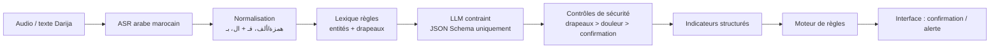

# 04 — Traitement de la Darija : de la voix à l'indicateur structuré

Ce module satisfait l'exigence **Niveau 1 ou 2** (ici : Niveau 1 livré, et
Niveau 2 adjoint sans opacité). Son rôle est de **comprendre**, jamais de
**décider** : la décision reste au moteur de règles puis à l'humain.

Fichiers associés : [`config/darija_lexicon.yaml`](../config/darija_lexicon.yaml),
[`examples/darija_output.json`](../examples/darija_output.json).

## 1. Pipeline



| Étape | Responsabilité | Rejet / repli |
| --- | --- | --- |
| ASR | transcription Darija | si confiance < 0,75 → afficher le texte et demander de répéter |
| Normalisation | « راني حسيت » → « أنا أحسست » ; « فالرجلين » → « في الرجلين » | jamais de correction sémantique automatique |
| Lexique | détecter effort, douleur, siège, temporalité, drapeaux | les drapeaux sont **toujours** évalués, même avec lexique incomplet |
| LLM contraint | produire uniquement le JSON du contrat ; aucune phrase libre | validation JSON Schema + refus si champ inattendu |
| Contrôles | drapeaux → `S0` ; NRS ≥ 4 → `R4` ; sinon confirmation pour changer la charge | une sortie non confirmée ne modifie jamais la charge |

## 2. Lexique minimal du MVP (extrait)

| Expression Darija | Sens | Indicateur | Valeur |
| --- | --- | --- | --- |
| `تعب خفيف`, `ما كاين حتى تعب` | fatigue légère | `rpe` | 2 |
| `تعب متوسط`, `تعب عادي` | fatigue modérée | `rpe` | 5 |
| `تعب كبير`, `صعب`, `تعبت بزاف` | fatigue importante | `rpe` | 7 |
| `ما قدرتش`, `تعبت بزاف بزاف` | effort très élevé | `rpe` | 9 |
| `ألم`, `وجع`, `كيوجعني` | douleur (≠ fatigue) | `nrs` | à quantifier |
| `ضغط فالصدر`, `ألم فالصدر` | douleur thoracique | `red_flag` | `chest_pain` |
| `دوخة`, `راسي كيدور`, `غميت` | vertige | `red_flag` | `vertigo` |
| `ضيق نفس`, `ما كنتنفسش مزيان` | essoufflement inhabituel | `red_flag` | `unusual_dyspnea` |
| `ألم حاد فمفصل`, `ركبتي كيوجعني بزاف` | douleur articulaire aiguë | `red_flag` | `acute_joint_pain` |
| `اليوم`, `النهار` | aujourd'hui | `temporal` | date courante |
| `فالرجلين`, `في الساقين` | jambes | `body_site` | `LEGS` |

> ** Piège sémantique majeur :** `تعب` (fatigue) n'est **pas** `ألم/وجع`
> (douleur). Une sortie vocale qui ne contient que « تعب » ne doit jamais
> produire un NRS. Le système pose la question de la douleur explicitement.

## 3. Exemple principal — « راني حسيت بتعب كبير اليوم فالرجلين »

### 3.1 transcription et traduction

- **Texte brut** : `راني حسيت بتعب كبير اليوم فالرجلين`
- **Arabe normalisé** : `أنا أحسست بتعب كبير اليوم في الرجلين`
- **Français** : « J'ai ressenti une forte fatigue aujourd'hui dans les jambes. »
- **Confiance ASR** : 0,93 · **Modalité** : `VOICE_DARIJA` · **Jeu de données** : synthétique

### 3.2 segmentation (indices de caractères)

| Segment | Indices | Rôle | Valeur produite |
| --- | --- | --- | --- |
| `راني حسيت` | `[0, 8]` | intention | `DECLARER_ETAT` |
| `بتعب كبير` | `[11, 18]` | effort perçu | `rpe = 7` (bande `ELEVE`) |
| `اليوم` | `[20, 24]` | temporalité | `TODAY` → 2026-11-17 (date synthétique) |
| `فالرجلين` | `[26, 33]` | siège | `LEGS` / « jambes » |
| — | — | douleur | **absente** (`nrs = null`) |
| — | — | drapeaux | **aucun** |

### 3.3 Indicateurs structurés

```json
{
  "intent": "DECLARER_ETAT",
  "state": { "value": "FATIGUED", "confidence": 0.86 },
  "rpe": {
    "value": 7,
    "scale": "0-10",
    "band": "ELEVE",
    "confidence": 0.72,
    "source_span": [11, 18],
    "confirmed_by_user": false
  },
  "nrs": {
    "value": null,
    "confidence": null,
    "reason": "تعب = fatigue ; aucun lexème de douleur (ألم / وجع) détecté"
  },
  "body_site": [
    { "value": "LEGS", "label_darija": "الرجلين", "confidence": 0.88, "source_span": [26, 33] }
  ],
  "temporal": { "value": "TODAY", "source_span": [20, 24] },
  "red_flags": []
}
```

### 3.4 Ambiguïtés et question de clarification

```json
{
  "ambiguities": [
    "« تعب كبير » est un ressenti subjectif : la valeur 7 est une estimation, pas une mesure.",
    "La fatigue des jambes peut être musculaire ou articulaire ; le type n'est pas spécifié."
  ],
  "follow_up_questions": [
    {
      "darija": "واش كاين ألم ولا وجع فالرجلين؟",
      "fr": "Y a-t-il une douleur dans les jambes ?",
      "maps_to": "nrs"
    },
    {
      "darija": "واش حسّيتي بضغط فالصدر ولا دوخة؟",
      "fr": "Avez-vous eu une douleur thoracique ou un vertige ?",
      "maps_to": "red_flags"
    }
  ]
}
```

### 3.5 Décision du moteur

**Avant confirmation de l'utilisateur** : la voix n'a pas été validée par un
appui sur l'écran I5 → règle `CONFIRM` :

> « Déclaration vocale non confirmée (confiance 0.72) : confirmation requise
> avant tout changement de charge. »
> `ar`: « تصريح صوتي غير مؤكد (الثقة 0.72): يلزم التأكيد قبل أي تغيير في الحمل. »

**Après appui sur « ✔️ تأكيد »** : `confirmed = true` et `0.72 ≥ 0,65` → le signal
devient exploitable pour `R1`/`R3` :

- si la séance précédente avait aussi `RPE ≥ 7` → **`R3`** : proposition
  d'allègement de 15 % + notification de l'encadrant ;
- sinon → aucun changement de charge ; le système demande la question de
  clarification sur la douleur et conserve le signal dans le dossier.

**Si l'utilisateur répond « أه، كاين ألم بزاف »** → `nrs = 7` → **`R4`** :
suspension et alerte kiné/médecin sous 5 minutes, sans attendre la validation
pour **émettre l'alerte** (la décision clinique reste humaine).

Le JSON complet est fourni dans
[`examples/darija_output.json`](../examples/darija_output.json).

## 4. Deuxième exemple — drapeau rouge (aucune confirmation requise)

- **Entrée** : `حسيت بضغط فالصدر و دوخة`
- **Traduction** : « J'ai ressenti une oppression thoracique et un vertige. »
- **Indicateurs** : `red_flags = ["chest_pain", "vertigo"]`, `nrs = null`, `rpe = null`
- **Décision** : **`S0` → `SUSPENDRE_IMMEDIATEMENT`**, sévérité `CRITICAL`,
  alerte encadrant + kiné + médecin, reprise uniquement sur décision humaine.

> Les drapeaux ne passent **jamais** par le filtre de confirmation : exiger un
> appui supplémentaire ici coûterait un temps précieux.

## 5. Tri intelligent du tableau de bord (Niveau 2)

Le score est calculé **uniquement** à partir de champs explicables :

```text
score = poids(action) + minutes_depuis_decision
poids(S0 / SUSPENDRE_IMMEDIATEMENT) = 100
poids(R4 / ALERTER_KINE_MEDECIN)    = 90
poids(R5 / APPEL_ENCADRANT)         = 50
poids(R3 / PROPOSER_ALLEGEMENT)     = 40
poids(R1 / PROPOSER_AUGMENTATION)   = 20
poids(R2 / MAINTENIR_CHARGE)        = 5
```

Chaque ligne de I7 affiche : `règle`, `action`, `heure`, `preuves` et la
décision humaine attendue. Exemple : « SYNTH-001 · `R3` · RPE 7 sur 2 séances ·
08:20 · proposition −15 % à valider ». Il n'y a **aucun modèle opaque**, donc
aucune justification à inventer après coup.

## 6. Gardes-fous

1. **Contrat de sortie strict** : JSON Schema, champs interdits hors nomenclature,
   0–10 borné, aucune phrase de diagnostic (« tu as… », « vous souffrez de… »).
2. **Drapeaux d'abord** : `S0` et `R4` court-circuitent le flux de confirmation.
3. **Confirmation pour la charge** : `confirmed == true` **et** confiance ≥ 0,65.
4. **Provenance** : chaque indicateur garde `source_span` et `confidence`.
5. **Repli** : si l'ASR échoue, l'interface revient aux 4 pastilles effort/douleur
   et aux 4 cases à cocher ; le pèlerin n'est jamais bloqué.
6. **Évaluation** : jeu de test **synthétique** annoté par des locuteurs Darija
   (cible : 60 phrases, dont 20 avec drapeaux, 20 avec douleur, 20 avec fatigue).
   Métriques : rappel sur les drapeaux (objectif 100 %), exactitude RPE par bande,
   taux de fausses alertes douleur.
7. **Limite connue** : la Darija varie selon les régions ; le lexique est
   extensible sans réentraînement et toute expression non reconnue déclenche une
   question de clarification, jamais une supposition silencieuse.
